<!-- Banner: assets/banner.svg (SVG próprio, preto e rosa) -->

  

  

  
  

 

## Sobre mim

Sou **Emilly Lorrany**, estudante do 2º semestre de **Análise e Desenvolvimento de Sistemas (ADS)** na **UDF** e desenvolvedora em formação, construindo minha trajetória na área de tecnologia.

Aqui ficam os projetos que construo enquanto estudo: lógica e algoritmos de ordenação em C, programas em Python e páginas web com HTML, CSS e JavaScript. Cada repositório registra um passo do caminho.

 

## Tecnologias

  

 

## ⭐ Projeto do semestre

  <a href="https://github.com/emillyy-cell/bubble-sort-farmacia">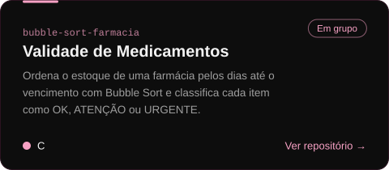</a>

**Controle de Validade de Medicamentos**: programa em C que ordena o estoque de uma farmácia pelos dias que faltam para o vencimento, com Bubble Sort, e classifica cada item como OK, ATENÇÃO ou URGENTE.

| Item | Informação |
|---|---|
| **Disciplina** | Algoritmos e Pensamento Computacional |
| **Instituição** | UDF |
| **Período** | 2º semestre de 2026 |
| **Desenvolvimento** | Projeto acadêmico em grupo (4 integrantes) |

  

 

## Projetos

<!-- Cards: assets/cards/*.svg (o card do projeto do semestre fica na seção acima) -->

  <a href="https://github.com/emillyy-cell/menu-utilitarios-python">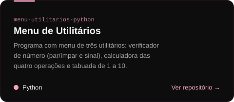</a>
  <a href="https://github.com/emillyy-cell/Algoritmos-e-Pensamento-Computacional">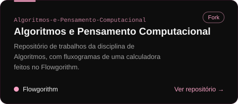</a>

  <a href="https://github.com/emillyy-cell/Lista-de-Compras">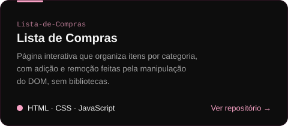</a>
  <a href="https://github.com/emillyy-cell/Sensor-de-Temperatura-em-C-">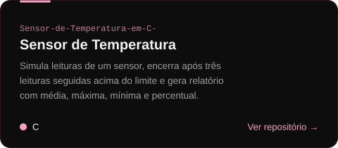</a>

  <a href="https://github.com/emillyy-cell/ordena-o-notas">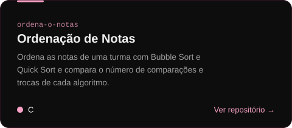</a>

 

## Estatísticas

<!-- Cards gerados diariamente por scripts/profile_cards.py (.github/workflows/profile.yml) na branch "output" -->

  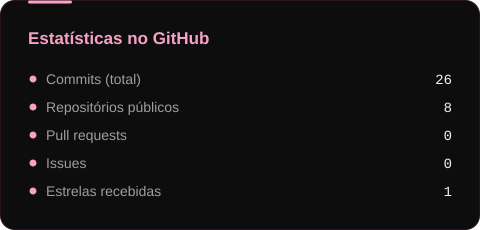
  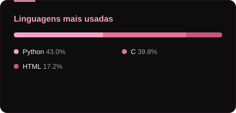

  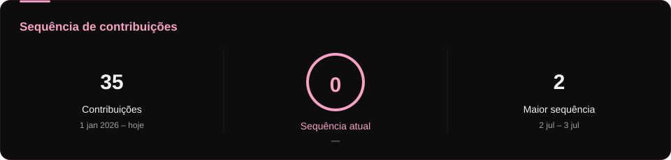

  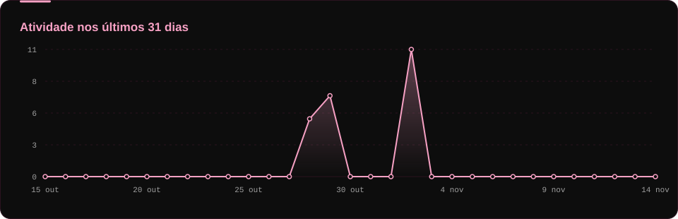

  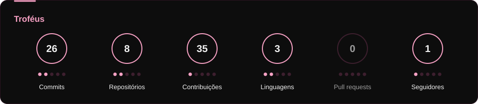

 

<!-- Snake: gerada por .github/workflows/profile.yml na branch "output" -->

  <picture>
    <source media="(prefers-color-scheme: dark)" srcset="https://raw.githubusercontent.com/emillyy-cell/emillyy-cell/output/github-snake-dark.svg" />
    <source media="(prefers-color-scheme: light)" srcset="https://raw.githubusercontent.com/emillyy-cell/emillyy-cell/output/github-snake.svg" />
    
  </picture>

 

## Contato

  
  

 

  

